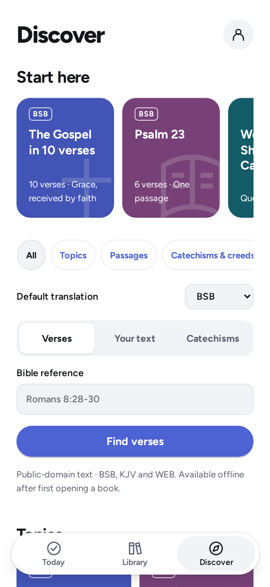

# Incord

*A little practice. A lasting word.*

Incord is an offline-first app for memorizing Scripture, historic catechisms and creeds, or your own text. Read along, practice the first letters of words as they gradually disappear, and return for spaced reviews. Install it as a progressive web app on your phone or use it in a browser. You can practice without an account; optional sign-in keeps your library and progress across devices.

[Use Incord](https://incord.jesklabs.com) · [Contributing](CONTRIBUTING.md) · [Security](SECURITY.md)



## Features

- Four-step first-letter learning, followed by FSRS spaced repetition and a capped, gentle-return backlog.
- BSB, KJV and WEB Bible packs; historic catechisms and creeds; custom text, whole passages and ten topical collections.
- Offline practice, light/dark themes, adjustable text size, and Incord keys with optional key sounds/haptics.
- Optional Google, email-code or email-free sign-in-code accounts, cross-device sync, and Web Push reminders.
- Small invite-only groups with shared goals, privacy-filtered practice rhythm and optional prayer encouragements.
- Optional device-only ESV quotations through the Crossway API.
- A remote MCP connection for compatible AI apps, with explicit authorization and revocation.

## Architecture

The frontend is Svelte 5 + TypeScript + Vite. IndexedDB is authoritative during offline practice; a service worker caches the app shell and Bible books opened on the device. The DOM-free engine in `src/engine` handles tokenization, masking, grading, learning transitions and FSRS scheduling.

Cloudflare serves existing static assets directly without invoking application code. One application Worker handles account APIs, ESV requests, MCP and extensionless app-route fallbacks. A separate, stateless legacy Worker redirects the old hostname. SQLite-backed Durable Objects hold account state (`UserDO`), registry/rate-limit/feedback state (`RegistryDO`), aggregate usage counts (`StatsDO`), OAuth provider state (`OAuthStorageDO`) and group state (`GroupDO`). There is no D1 database or separate MCP Worker. Sync uses last-write-wins items, per-field preference clocks and append-only, idempotent review events; device-only items require an explicit ownership choice before account sync.

## Development

Use Node.js 24 and npm. Normal builds use committed content and do not download upstream Scripture.

```sh
npm ci
cp cloudflare/dev.vars.example .dev.vars
npm run dev
```

Edit the ignored `.dev.vars` with fresh local values, replacing the example placeholders. Alternatively, before creating that file, `node scripts/local-secrets.mjs` generates local session, stats and VAPID keys; it preserves an existing file. Never commit credentials.

`npm run dev` starts Vite's frontend development server. **It does not run the Worker API and has no API proxy configured.** For the complete app, including sign-in, sync and MCP, run Wrangler instead:

```sh
npm run serve
```

Open http://localhost:8793. Wrangler's build hook rebuilds the frontend automatically. Local Durable Object state stays in `.wrangler`; browser practice stays in IndexedDB. Local operation does not deploy anything. Google, email delivery, ESV and push require their optional configuration below.

### Checks

```sh
npm run check
npm test
npm run build
npm run content:verify
npx playwright install chromium webkit
npm run e2e
```

E2E tests use disposable localhost accounts and mocked provider behavior. Stop an existing local Wrangler process before final E2E verification: Playwright may reuse it, including an older Worker bundle. Content refresh instructions and reproducible snapshots are in [content/SOURCES.md](content/SOURCES.md).

For local email-code testing, set `EMAIL_TEST_SINK=1` only on localhost; `/api/test/last-code?email=person%40example.com` exposes the last unexpired test code there without sending mail. The sink is rejected on public hosts. Normal tests never make live ESV calls. The opt-in `ESV_LIVE_SMOKE=1 WORKER_URL=http://localhost:8793 npm run smoke:esv` makes one real request without retries and needs a valid ESV key.

## Deploy your own instance

You need a Cloudflare account with Workers and SQLite Durable Objects, and Wrangler authentication (`npx wrangler login`, or your own Cloudflare CI credentials). Copy/adapt `wrangler.jsonc`: use your own Worker name and routes (or enable your own `workers.dev` address), and set `APP_ORIGIN` to your deployed HTTPS origin. The committed routes and `scripts/deploy.sh` target the maintained Incord service; do not use them unchanged for a fork.

Preserve the Durable Object classes, bindings and additive migration sequence. For an existing deployment, never rename persistent Worker/DO identities or internal storage keys: doing so can strand accounts. Wrangler creates the declared Durable Objects through migrations; no manual KV namespace or D1 provisioning is needed. The included 15-minute cron checks reminders.

Configure secrets with `npx wrangler secret put NAME`; do not put secret values in Wrangler config or source control.

| Setting | Purpose |
| --- | --- |
| `SESSION_SECRET` | Required: strong random secret of at least 32 characters for sessions, identity hashes and OAuth encryption. Keep stable across releases. |
| `APP_ORIGIN` | Required for deployment: your canonical HTTPS origin; set as a Wrangler variable or deploy-time `--var`. Leave unset for origin-agnostic local use. |
| `STATS_TOKEN` | Optional private `/stats` dashboard and orphan-account maintenance access; use a separate strong random secret. Never put it in a URL. |
| `RESEND_API_KEY` | Optional email-code sign-in and feedback email notifications via Resend. |
| `EMAIL_FROM` | Sender identity for Resend. Set your own verified sender; otherwise the maintained service's default sender is used. |
| `GOOGLE_CLIENT_ID`, `GOOGLE_CLIENT_SECRET` | Optional Google sign-in. Register your origin's `/api/auth/google/callback` as the callback. |
| `VAPID_PUBLIC_KEY`, `VAPID_PRIVATE_KEY`, `VAPID_SUBJECT` | Optional Web Push: matching P-256 public/private keys and operator contact URI. Private key is the base64url raw scalar. Keep keys stable. |
| `DONATE_URL` | Optional public Wrangler variable: HTTPS support link, shown only in About and Connect. |
| `ESV_API_KEY` | Optional server-side Crossway API access, subject to Crossway's conditions. ESV is never bundled. |

MCP reuses `SESSION_SECRET` and `APP_ORIGIN`; no additional MCP secret is needed. Review service-specific sender/contact defaults before hosting your own instance. Build and commit your release before deployment so the displayed version matches the deployed source. After adapting configuration and setting secrets:

```sh
npx wrangler deploy --var APP_ORIGIN:https://your-own-domain.example
```

Wrangler rebuilds assets before upload. A production smoke test is not part of normal checks: `scripts/prod-smoke.mjs` targets the maintained live service by default and has operator-specific mailbox integration. Do not run it unchanged for a fork; use your own test account, code reader and explicit `SMOKE_URL`.

### Asset routing and the legacy hostname

Existing JS, CSS, fonts and content files are served directly by Workers Static Assets, avoiding an application Worker invocation. `assets.run_worker_first` reserves dynamic paths for the Worker. We deliberately retain `not_found_handling: "none"`: Cloudflare's automatic SPA mode can turn missing asset navigations into `index.html`. Instead, the Worker supplies a shell only for extensionless HTML app-route misses; missing `/assets/*` and `/content/*` files stay 404. `public/_headers` mirrors the Worker's security headers, including CSP, HSTS and `no-transform`; the service worker is revalidated with `no-cache`.

The maintained legacy host, `byheart.jesklabs.com`, uses the tiny, independent [legacy redirect Worker](cloudflare/legacy-redirect/worker.ts). It preserves path/query redirects to Incord, returns 410 for old APIs and serves the self-unregistering service worker. It has no assets or Durable Object bindings. For this route migration, deploy in this order:

1. Deploy the main Worker with the updated root `wrangler.jsonc`, which removes its old-host custom-domain route. Keep the existing `byheart` Worker name and persistent bindings.
2. Deploy the redirect Worker to claim that released route:

   ```sh
   npx wrangler deploy --config cloudflare/legacy-redirect/wrangler.jsonc
   ```

There may be a short old-host gap between those deployments. Forks without a legacy hostname need only the main Worker; otherwise adapt both the legacy route and redirect destination. The main deploy script does not deploy the redirect Worker.

### Email-free code accounts

Account settings can create an account without email or Google. A sign-in code has three kid-safe compound words and four digits (46.28 bits of cryptographic entropy). Save it privately: without a linked email/Google method, a lost code cannot be recovered. Code sign-in accepts case-insensitive input with or without hyphens. Regeneration invalidates the old code but leaves existing device sessions signed in.

The server stores only a domain-separated HMAC under `SESSION_SECRET`, never the code itself. The browser keeps a device-only copy after creation or code sign-in; Reveal requires a tap, and sign-out clears the copy. Codes are excluded from library sync and export. A device without a copy can regenerate a code, not retrieve it. Code creation and sign-in share a 10-attempt/IP/15-minute limit, with IPv6 clients grouped by /64, a global 10,000-failed-sign-in budget and a separate 1,000-new-account budget per 15 minutes. No email or Google provider credentials are needed for code accounts.

### Orphan-account maintenance

After retiring a sign-in method, an operator can inspect accounts with **no email, Google or sign-in-code mapping**. `POST /stats/maintenance/orphans` uses the same signed administrator cookie as `/stats`, or `Authorization: Bearer $STATS_TOKEN`. Send a matching `Origin` header and JSON. The default is a dry run; an empty body or `{}` does not delete anything.

```sh
# Set ORIGIN to your instance and supply STATS_TOKEN in your shell environment.
curl --fail-with-body "$ORIGIN/stats/maintenance/orphans" \
  -H "Authorization: Bearer $STATS_TOKEN" -H "Origin: $ORIGIN" \
  -H 'Content-Type: application/json' --data '{"limit":10}'
```

The response includes counts and selected creation dates only (UTC dates, or `null` if unavailable), never account IDs or library contents. `limit` defaults to 10 and is capped at 25 to bound each request's work. Inspect the dry run before sending `{"confirm":true,"limit":10}` to permanently delete the selected orphans. Repeat bounded batches until none remain. Confirmation runs the same deletion path as the app: OAuth revocation, group removal, UserDO data and push subscriptions, then registry mappings. Mapping checks and durable deletion claims prevent an email/Google/code-linked account from being selected during a concurrent sign-in. A failed batch may have completed earlier deletions; retrying is safe.

Cloudflare does not enumerate named UserDOs. Maintenance discovers historical accounts from retained registry mappings, scheduling entries, pending identity challenges and group memberships, and maintains a durable index thereafter. A historical object with no surviving registry reference cannot be found by this endpoint. HTTP GET never performs maintenance. Keep the stats token private; do not put it in a URL or logs.

## MCP

See [Connect an app](https://incord.jesklabs.com/connect.html). The maintained endpoint is `https://incord.jesklabs.com/mcp`; self-hosted instances use their own origin plus `/mcp`. It uses Streamable HTTP and OAuth, with dynamic client registration. Claude connectors/Claude Code and other remote-MCP/OAuth-compatible clients can connect; support depends on client, plan and workspace policy.

Users approve read and optional add-only library access. Connected apps cannot edit or delete existing items. Revoke a connection in Settings → Connected apps. Calls accept at most 50 inputs, 500 verses per reference and 1,000 expanded items, with per-input results. ESV text is never exposed through MCP; ESV references remain whole passages. `get_groups` offers read-only, privacy-filtered group views; it cannot manage groups. `send_feedback` accepts explicit feedback even with a read-only token. OAuth state lives in the existing `OAUTH_STORAGE` Durable Object, not a separate KV service.

## Privacy

Practice without signing in stays on your device. With an account, explicitly claimed public-domain/custom items, preferences and review history sync to the server. ESV quotations stay device-only and are excluded from server sync and text storage. Signing out clears synced account data from that device after synchronization; account deletion and export are available in the app.

There are no ads or third-party trackers. Optional first-party anonymous usage counts honor the app's opt-out, Global Privacy Control and Do Not Track. Counts have no account ID, IP, user agent, text or passage references; daily rotating device tokens are removed after rollup. Weekly activity sums daily counts, not unique weekly people. Separate sanitized operational logs help diagnose failures.

Feedback includes only the submitted message, optional explicit reply address, and any device details the user chooses to attach; library data is never attached. Server-side validation and rate limits protect submissions. Email, Google, push and Crossway contact their respective providers only when those features are used. See the app's [privacy policy](https://incord.jesklabs.com/privacy.html) for the maintained service.

## Content and licensing

Original project code is licensed under the **MIT License**; see [LICENSE](LICENSE) and [NOTICE](NOTICE).

Bundled BSB and WEB text and identified historic catechism/creed editions are public domain. KJV is public domain in the United States; United Kingdom Crown rights are not waived. Edition details, source snapshots and transformation notes are in [content/SOURCES.md](content/SOURCES.md). Font files retain their separate SIL OFL 1.1 licenses under [public/licenses](public/licenses).

ESV is copyrighted and **not bundled or relicensed under MIT**. The optional proxy does not cache quotations server-side; device storage is limited to 500 verses and no more than half of any book, whichever is less. Quotations remain unaltered and carry linked ESV attribution. The exact required notice and download restriction are reproduced in [NOTICE](NOTICE).

## Contributing and help

Bug reports, ideas and small focused pull requests are welcome; see [CONTRIBUTING.md](CONTRIBUTING.md). Use GitHub issues for non-sensitive reports and [SECURITY.md](SECURITY.md) for private vulnerability disclosure. General contact: [incord@jesklabs.com](mailto:incord@jesklabs.com).

To include an optional support link in this static README, set `DONATE_URL` in `wrangler.jsonc` and run `npm run docs:support` before committing. With no URL set, no Support section renders.

<!-- SUPPORT:START -->
## Support

[Support Jesklabs](<https://ko-fi.com/jesklabs>)

<!-- SUPPORT:END -->
